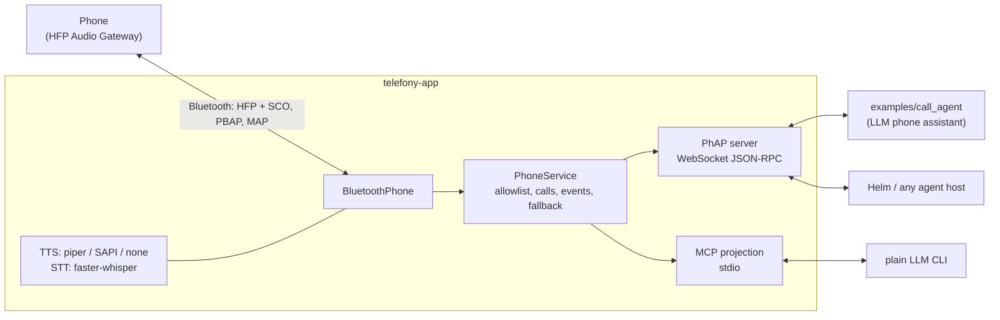

# telefony-app

> **Status: in development.** Expect rough edges and breaking changes; YMMV with your phone, Bluetooth dongle and OS.

The sample **[PhAP](https://github.com/PetePeter/phone-agent-protocol) implementation**: a PhAP server, plus an example LLM host that uses it. A PC pretends to be a Bluetooth hands-free unit (a car kit), so AI agents can use a real Android phone or iPhone. They can:

- place and answer calls, and talk on them
- press keys on menus, and hear the keys a caller presses (DTMF)
- run conference calls
- send and read SMS
- search contacts



| Interface | For | Scope |
|---|---|---|
| **PhAP 2026-10-27** on `ws://127.0.0.1:7781/phap` | agent hosts (Helm) | Full: inbound calls and SMS as pushed events, live calls, conference, resume |
| **MCP** on stdio (`--mcp`, instead of PhAP) | Claude Code, Codex, Copilot... | Outbound only: `dial`, `say`, `press`, `listen`, `hangup`, SMS, contacts, status |

## Layers

| Module | Role |
|---|---|
| `service.py` | `PhoneService`: the single source of truth for calls, allowlist enforcement, the fallback policy, transcripts and the event log. Both protocols are thin views of it; a run serves one or the other, never both. |
| `phap/server.py` | PhAP: hello/welcome, roles, schema-shaped results and errors, idempotent methods, resume, heartbeat. |
| `mcp_projection.py` | MCP tools. `listen` blocks for the caller's next words or key presses, buffered while `say` plays. |
| `phone.py` | The `Phone` port, so the service never sees Bluetooth. |
| `bt/` | The Bluetooth implementation of that port (HfLine, a DTMF decoder, OBEX/PBAP/MAP), from the telefony-cube proof of concept. |
| `voice.py` | TTS backends, chosen by `voice.tts`: Piper as a separate process, or Windows SAPI, or none (`call.say` then returns `1006 unsupported`). Also faster-whisper STT. |
| `config.py` | TOML config, read once at startup. Neither protocol can change it. |

## Example LLM host: call_agent

[`examples/call_agent`](examples/call_agent/README.md) is a PhAP client that answers allowlisted callers with an LLM (any OpenAI-compatible API). It can tell the time and weather, conference someone in, text someone and hold the call. The LLM only names people from the agent's own phonebook and never sees a phone number. It rejects private numbers, and only the caller (or the caller's request) ends a call.

## Setup

**[SETUP.md](SETUP.md)** walks through everything step by step, written so an AI agent can run it: the venv, the dongle and its Zadig/libusbK driver, the config, pairing the phone, Piper, and the call agent. Short version:

```sh
python -m venv .venv
.venv/Scripts/pip install -e ".[stt,dev]"
cp telefony.example.toml telefony.toml            # dongle, token, allowlist
.venv/Scripts/telefony-app telefony.toml          # PhAP server (or add --mcp for MCP on stdio instead)
.venv/Scripts/python -m examples.call_agent init  # then edit %APPDATA%/telefony-call-agent/*
.venv/Scripts/python -m examples.call_agent       # the LLM host
.venv/Scripts/pytest                              # tests, no hardware needed
```

The app serves **one or the other**: PhAP by default, or MCP on stdio with `--mcp`. Example MCP client entry:

```json
{"mcpServers": {"telefony": {"command": "<path-to>/telefony-app/.venv/Scripts/telefony-app.exe",
                             "args": ["<path-to>/telefony-app/telefony.toml", "--mcp"]}}}
```

## Compliance

The tests drive the real `PhoneService` and PhAP server over a real WebSocket, with a fake phone standing in for the hardware. They check **every frame the server sends** against the vendored PhAP JSON Schema (`src/telefony_app/phap/schema-2026-10-27.json`). The Bluetooth modules keep their own regression tests from the proof of concept.

## Status and limits (v0.1)

- One phone, one conference.
- No barge-in. While the app is speaking, the caller's speech is not transcribed.
- If the Bluetooth link drops, the app reports `link: down`. Restart it to reconnect.
- Tested on an iPhone: outgoing and incoming calls, speech both ways, the call agent. Conference and SMS through the agent are covered by tests, not yet live.

## License

MIT. See [THIRD_PARTY_NOTICES.md](THIRD_PARTY_NOTICES.md).
