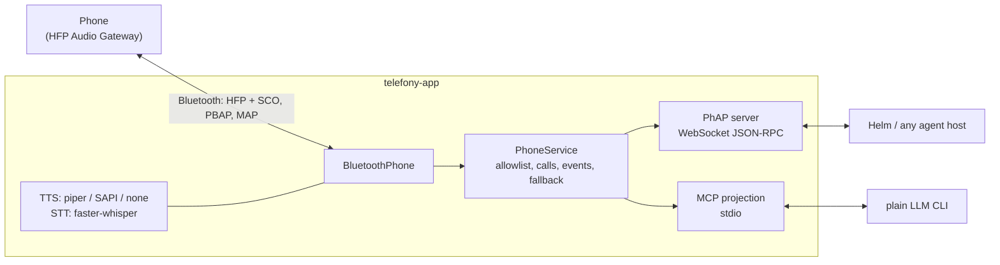

# telefony-app

The reference **[PhAP](https://github.com/PetePeter/phone-agent-protocol) server**. A PC pretends to be a Bluetooth hands-free unit (a car kit), so AI agents can use a real Android phone or iPhone. They can:

- place and answer calls, and talk on them
- run conference calls
- send and read SMS
- search contacts



| Interface | For | Scope |
|---|---|---|
| **PhAP 2026-10-27** on `ws://127.0.0.1:7781/phap` | agent hosts (Helm) | Full: inbound calls and SMS as pushed events, live calls, conference, resume |
| **MCP** on stdio (`--mcp`, instead of PhAP) | Claude Code, Codex, Copilot... | Outbound only: `dial`, `say`, `listen`, `hangup`, SMS, contacts, status |

## Layers

| Module | Role |
|---|---|
| `service.py` | `PhoneService`: the single source of truth for calls, allowlist enforcement, the fallback policy, transcripts and the event log. Both protocols are thin views of it; a run serves one or the other, never both. |
| `phap/server.py` | PhAP: hello/welcome, roles, schema-shaped results and errors, idempotent methods, resume, heartbeat. |
| `mcp_projection.py` | MCP tools. `listen` blocks for the caller's next words, buffered while `say` plays. |
| `phone.py` | The `Phone` port, so the service never sees Bluetooth. |
| `bt/` | The Bluetooth implementation of that port (HfLine, OBEX/PBAP/MAP), from the telefony-cube proof of concept. |
| `voice.py` | TTS backends, chosen by `voice.tts`: Piper as a separate process, or Windows SAPI, or none (`call.say` then returns `1006 unsupported`). Also faster-whisper STT. |
| `config.py` | TOML config, read once at startup. Neither protocol can change it. |

## Setup

```sh
python -m venv .venv
.venv/Scripts/pip install -e ".[stt,dev]"
cp telefony.example.toml telefony.toml   # set the token, the allowlist and the dongle
```

**Dongle:** use a dedicated USB Bluetooth adapter bound to **libusbK** with [Zadig](https://zadig.akeo.ie/). Windows stops using that adapter. See the telefony-cube notes for why the Windows stack can't be used: it gives apps no access to SCO call audio.

**Voice:** with no extra setup, `tts = "auto"` uses the built-in Windows voice. For Piper, install the `piper` executable yourself and set `voice.piper_model`. Piper is GPL-3.0, so telefony-app only ever runs it as a separate program.

## Run

The app serves **one or the other**: PhAP by default, or MCP on stdio with `--mcp` (no PhAP server then).

```sh
.venv/Scripts/telefony-app telefony.toml          # PhAP server only
.venv/Scripts/telefony-app telefony.toml --mcp    # MCP on stdio instead (an LLM CLI launches this)
.venv/Scripts/pytest                              # tests, no hardware needed
```

Example MCP client entry:

```json
{"mcpServers": {"telefony": {"command": "X:/coding/telefony-app/.venv/Scripts/telefony-app.exe",
                             "args": ["X:/coding/telefony-app/telefony.toml", "--mcp"]}}}
```

## Compliance

The tests drive the real `PhoneService` and PhAP server over a real WebSocket, with a fake phone standing in for the hardware. They check **every frame the server sends** against the vendored PhAP JSON Schema (`src/telefony_app/phap/schema-2026-10-27.json`). The Bluetooth modules keep their own regression tests from the proof of concept.

## Status and limits (v0.1)

- One phone, one conference.
- No barge-in. While the app is speaking, the caller's speech is not transcribed.
- If the Bluetooth link drops, the app reports `link: down`. Restart it to reconnect.
- The real-phone wiring (`bt/bluetooth_phone.py`, `main.py`) still needs manual testing with hardware.

## License

MIT. See [THIRD_PARTY_NOTICES.md](THIRD_PARTY_NOTICES.md).
