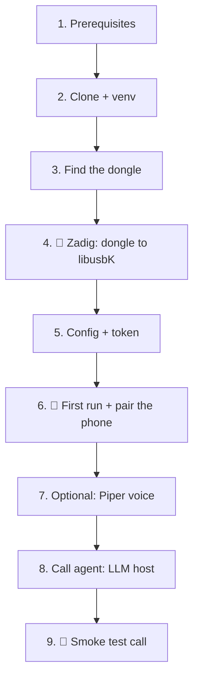

# Setup, step by step

Written so an AI agent (or a person) can follow it top to bottom on **Windows 10/11**. Each step has a **Verify** line: do not go on until it passes. Steps marked **👤 HUMAN** need hands on the PC or the phone; an agent must stop there, tell the user exactly what to do, and wait.



## 1. Prerequisites

- Python **3.12** and git on PATH.
- A **second USB Bluetooth dongle**, used only by telefony-app (Windows loses access to it). Tested: Actions Semiconductor `10D7:B012`. Keep the PC's built-in Bluetooth for everything else.
- An Android phone or iPhone, with a spare allowlisted number to test calls from.

**Verify:** `python --version` prints 3.12.x; `git --version` works.

## 2. Clone and install

```sh
git clone https://github.com/PetePeter/telefony-app.git
cd telefony-app
python -m venv .venv
.venv/Scripts/pip install -e ".[stt,dev]"
```

**Verify:** `.venv/Scripts/pytest -q` passes (no hardware needed).

## 3. Find the dongle

Plug the dongle in, then list Bluetooth radios with their USB IDs:

```powershell
Get-PnpDevice -Class Bluetooth -PresentOnly | Where-Object InstanceId -like 'USB\VID_*' | Select-Object FriendlyName, InstanceId
```

The `InstanceId` holds `VID_xxxx&PID_yyyy`. Pick the one that is **not** the built-in adapter (unplug it and re-run to be sure). Note `VID:PID`, e.g. `10D7:B012`.

**Verify:** you have one `VID:PID` that disappears from the list when the dongle is unplugged.

## 4. 👤 HUMAN: bind the dongle to libusbK with Zadig

Bumble drives the dongle from user space, so Windows' Bluetooth driver must let go of it. The agent can download Zadig; a person runs it (it needs admin and a GUI):

```powershell
Invoke-WebRequest https://github.com/pbatard/libwdi/releases/download/v1.5.1/zadig-2.9.exe -OutFile $env:USERPROFILE\Downloads\zadig.exe
```

In Zadig: **Options → List All Devices** → pick the dongle (check the USB ID shows the same `VID PID`) → choose **libusbK** → **Replace Driver**. Use libusbK, not WinUSB: WinUSB opens the dongle but its isochronous transfers (call audio, SCO) fail.

To undo later: Device Manager → the dongle → Uninstall device (tick "delete the driver"), then re-plug.

**Verify:** `.venv/Scripts/bumble-usb-probe` lists the dongle with its `VID:PID`.

## 5. Config and token

```sh
cp telefony.example.toml telefony.toml
.venv/Scripts/python -c "import secrets; print(secrets.token_urlsafe(24))"
```

Edit `telefony.toml`:
- `[device] transport = "usb:VID:PID+sco=2"`: your dongle from step 3.
- `[phap] token`: the generated token. Every PhAP client needs it.
- `[policy] allowlist`: the numbers that may call in and be called. **Never commit real numbers**: keep `telefony.toml` out of git, or outside the repo.
- `[voice] tts = "auto"` uses the built-in Windows voice; `stt_model = "small.en"` downloads a whisper model (~500 MB) on first run.
- Optional `[voice] sapi_voice = "Microsoft Zira Desktop"` selects that exact installed Windows SAPI voice.

**Verify:** `.venv/Scripts/python -c "from telefony_app.config import load_config; print(load_config('telefony.toml'))"` prints the config without an error.

## 6. 👤 HUMAN: first run and pairing

```sh
.venv/Scripts/telefony-app telefony.toml
```

The first time, the PC shows up as **telefony**. On the phone: Settings → Bluetooth → pair **telefony**. On an **iPhone**, then tap ⓘ next to telefony and turn on:
- **Show Notifications** (needed for SMS; without it MAP is refused with `0xC3 Forbidden`)
- **Sync Contacts** (needed for contacts over PBAP). iOS only shows this switch after a device has asked for the phonebook; telefony asks once each time it connects, so the switch appears a few seconds after the first connect.

The pairing is remembered; later runs reconnect by themselves.

**Verify:** the log shows `phone connected` and then `PhAP listening on ws://127.0.0.1:7781/phap`. `phone refused caller ID notifications (AT+CLIP)` should not appear (see Troubleshooting).

## 7. Optional: Piper voice

The Windows voice works with no setup. For Piper (GPL-3.0, so telefony-app only ever runs it as a separate program), install it (`.venv/Scripts/pip install piper-tts`; the venv copy is found even when the venv is not activated, otherwise put `piper` on PATH), download a voice and set it in the config:

```sh
mkdir models
curl -L -o models/en_GB-alan-medium.onnx      https://huggingface.co/rhasspy/piper-voices/resolve/main/en/en_GB/alan/medium/en_GB-alan-medium.onnx
curl -L -o models/en_GB-alan-medium.onnx.json https://huggingface.co/rhasspy/piper-voices/resolve/main/en/en_GB/alan/medium/en_GB-alan-medium.onnx.json
```

`[voice] tts = "piper"`, `piper_model = "models/en_GB-alan-medium.onnx"`.

Any Piper voice works, including your own: keep the `.onnx.json` next to the `.onnx` (its sample rate is read from there), and absolute paths with spaces are fine, e.g. `piper_model = "E:/Voices/me/me.onnx"`. One way to make one: clone your voice with a zero-shot TTS (e.g. Qwen3-TTS), synthesise a couple of thousand sentences with it, then fine-tune a Piper voice from `en_GB-alan-medium` on those clips.

**Verify:** the startup log says `text-to-speech: PiperTts`.

## 8. The call agent (example LLM host)

With telefony-app running, in a second terminal:

```sh
.venv/Scripts/python -m examples.call_agent init
```

This creates `%APPDATA%\telefony-call-agent\` with `call_agent.toml` and `phonebook.csv`. Edit them:
- `call_agent.toml`: `[phap] token` = the token from step 5; `[llm]` = any OpenAI-compatible API (OpenRouter by default, or a local llama-server); `[weather]` = your location.
- `phonebook.csv`: `name,number` per line: the only people the agent can call or text. They must also be on telefony-app's allowlist.

Put the LLM key in the environment variable the config names (default `OPENROUTER_API_KEY`):

```powershell
setx OPENROUTER_API_KEY "sk-or-..."    # then open a new terminal
```

```sh
.venv/Scripts/python -m examples.call_agent
```

**Verify:** the log shows `connected to ws://127.0.0.1:7781/phap; N people in the phonebook`.

## 9. 👤 HUMAN: smoke test

Call the paired phone from an allowlisted number. The agent answers and greets you; ask the time or the weather, then say goodbye and ask it to hang up.

**Verify:** the agent log shows `heard:` and `saying:` lines, and the call ends. **No call may be left up**: if anything hangs, stop both programs (Ctrl+C) and check the phone.

## Troubleshooting

| Symptom | Cause / fix |
|---|---|
| `bumble-usb-probe` shows nothing | Zadig bound the wrong device, or the dongle is on WinUSB/Windows' driver. Redo step 4. |
| Calls connect but there is no audio | WinUSB instead of libusbK, or a missing `+sco=2` in the transport. |
| The phone pairs but never reconnects | The phone forgot the pairing: remove telefony on the phone and pair again. |
| SMS tools fail on an iPhone | Show Notifications is off for telefony (step 6). |
| `phone refused caller ID notifications (AT+CLIP)`; incoming calls show no number | The HF did not advertise *CLI presentation* in `AT+BRSF`; iOS then answers `AT+CLIP=1` with `ERROR`. `HF_CONFIGURATION` in `bt/hf_line.py` must include `HfFeature.CLI_PRESENTATION_CAPABILITY`. Contact sharing does not affect caller ID. |
| The link drops every 30-60 s with `dropped (reason 8)` | Supervision timeout: the radio went silent. Re-pair the phone, turn off USB selective suspend (`powercfg`, USB settings), and keep the dongle away from USB 3 ports. telefony also polls the link every 5 s (`bt/link.py`). |
| The agent never answers | The caller is not on the allowlist, or the caller ID is withheld (private numbers are rejected). |
