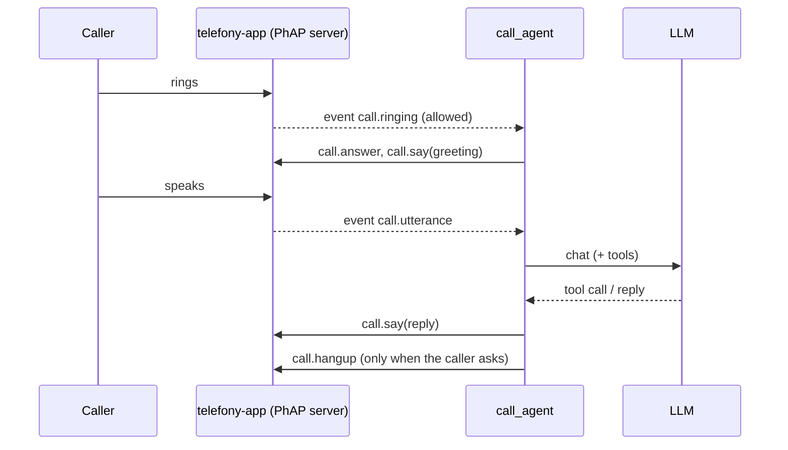

# call_agent: a demo PhAP client

A closed-loop phone assistant. It connects to a running telefony-app as the PhAP controller, answers **allowlisted** callers only, and talks through an LLM. Its tools:

| Tool | Does |
|---|---|
| `time_now` | the local date and time |
| `weather` | now, today and tomorrow, from [Open-Meteo](https://open-meteo.com/) (free, no key) |
| `hang_up` | ends the call after the goodbye |
| `add_to_call`, `merge_calls`, `hold`, `resume` | conference someone in (`conference.create`/`join`), hold |
| `send_sms`, `list_sms`, `read_sms` | texts (`sms.*`) |
| `find_contact`, `phone_status`, `call_transcript` | `contacts.search`, `status`, `transcript.get` |

Every dial and text still goes through telefony-app's allowlist, so the LLM cannot reach anyone else. Each line heard, said and each tool call is logged.



The LLM is any OpenAI-compatible chat API: OpenRouter, or a local llama-server. If it fails, the agent apologises and hangs up.

## Run

```sh
cp examples/call_agent/call_agent.example.toml call_agent.toml   # set the PhAP token and the LLM
set OPENROUTER_API_KEY=...
.venv/Scripts/telefony-app telefony.toml                          # needs voice.stt_model: pip install -e ".[stt]"
.venv/Scripts/python -m examples.call_agent call_agent.toml
```

Tests: `tests/examples/`, against the real PhAP server with a fake phone and a scripted LLM.
