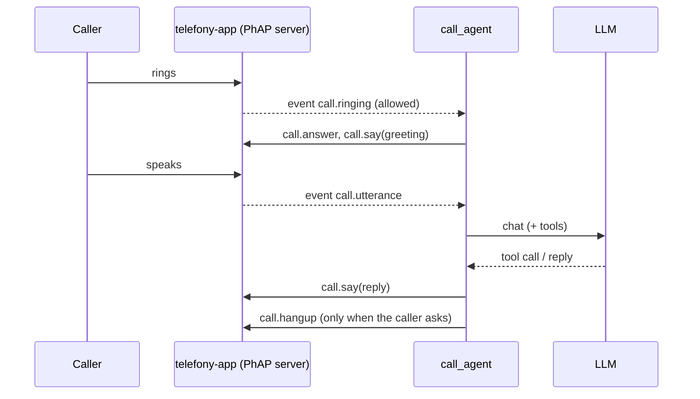

# call_agent: a demo PhAP client

A closed-loop phone assistant. It connects to a running telefony-app as the PhAP controller, answers **allowlisted** callers only (private numbers are rejected), and talks through an LLM. Its tools:

| Tool | Does |
|---|---|
| `time_now` | the local date and time |
| `weather` | now, today and tomorrow, from [Open-Meteo](https://open-meteo.com/) (free, no key) |
| `hang_up` | ends the call after the goodbye |
| `add_to_call(name)` | calls someone from the phonebook and conferences them in |
| `send_sms(name, text)` | texts someone from the phonebook |
| `hold`, `resume`, `merge_calls` | call controls |

**The LLM never sees a phone number or the phone's address book.** It names people; the agent looks the name up in its own `phonebook.csv` and does nothing unless exactly one entry matches. Unknown, ambiguous and app-blocked names all get the same answer ("I can't reach that person"), so a caller cannot probe who is in the phonebook. The app's allowlist still checks every number. Each line heard, said and each tool call is logged.



The LLM is any OpenAI-compatible chat API: OpenRouter, or a local llama-server. If it fails, the agent apologises and hangs up.

## Run

```sh
.venv/Scripts/python -m examples.call_agent init                 # creates %APPDATA%/telefony-call-agent (or ~/.config/...)
#   edit call_agent.toml there (PhAP token, LLM) and phonebook.csv (name,number per line)
set OPENROUTER_API_KEY=...
.venv/Scripts/telefony-app telefony.toml                          # needs voice.stt_model: pip install -e ".[stt]"
.venv/Scripts/python -m examples.call_agent
```

Tests: `tests/examples/`, against the real PhAP server with a fake phone and a scripted LLM.
